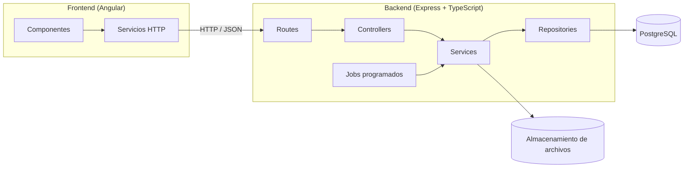
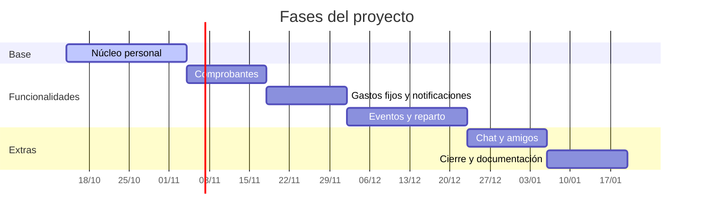

<a id="top"></a>

<div align="center">


<br>

[](#planificacion)
[](./LICENSE)


<br>

[`Características`](#caracteristicas) [`Capturas`](#capturas) [`Arquitectura`](#arquitectura) [`Modelo de datos`](#modelo-de-datos)  [`Planificación`](#planificacion) [`Tecnologías`](#tecnologias) [`Instalación`](#instalacion) 

</div>

---

**UnMango** es una aplicación web, instalable como PWA, para gestionar gastos personales y compartidos. Permite cargar gastos a mano o con un comprobante, controlar gastos fijos con recordatorios y dividir cuentas entre amigos sin hacer cálculos.

> [!NOTE]
> El proyecto está en desarrollo activo. Algunas funcionalidades todavía no están disponibles. El avance por fase se detalla en [Planificación](#planificacion).

<a id="caracteristicas"></a>
<div align="center">
  
</div>

---

| Funcionalidad | Descripción |
|---|---|
| **Registro de gastos** | Carga manual o por comprobante: el sistema propone monto, fecha y destinatario, y el usuario confirma. |
| **Planilla y gráficas** | Categorías, búsqueda, orden, paginación y resumen visual por período. |
| **Gastos fijos** | Alquiler, servicios y suscripciones con periodicidad semanal o mensual. |
| **Recordatorios** | Avisos antes del vencimiento y diarios hasta que se marca el pago. |
| **Eventos con amigos** | Gastos compartidos con reparto equitativo, por porcentaje o por monto exacto. |
| **Simplificación de deudas** | Calcula la menor cantidad de transferencias para dejar todo saldado. |
| **PWA** | Instalable en Android y compatible con compartir comprobantes desde otras aplicaciones. |

<details>
<summary>Cómo se calcula el balance de cada persona</summary>

Para cada integrante de un evento, el balance neto es la diferencia entre lo que pagó y lo que le corresponde:

$$\text{balance}_i = \text{pagado}_i - \text{corresponde}_i$$

Un balance positivo indica que la persona tiene que recibir dinero; uno negativo, que tiene que pagar. La simplificación de deudas empareja al mayor deudor con el mayor acreedor hasta que todos los balances llegan a cero.

Todos los montos se guardan en centavos como números enteros.[^1]
</details>

[^1]: Se evita el uso de números decimales para no acumular errores de redondeo al repartir gastos.

[Volver arriba](#top)

<a id="capturas"></a>
<div align="center">
  
</div>

---

<!-- Agregá tus capturas en docs/assets/ -->

<div align="center">

| Planilla de gastos | Gastos fijos | Evento con amigos |
|:---:|:---:|:---:|
| [](docs/assets/planilla.png) | [](docs/assets/fijos.png) | [](docs/assets/eventos.png) |

</div>

[Volver arriba](#top)

<a id="arquitectura"></a>
<div align="center">
  
</div>

---

Dos capas independientes que se comunican por HTTP. El backend sigue una arquitectura en capas y expone una API REST.



```
.
├── frontend/     # Aplicación Angular
├── backend/      # API REST (Express + Prisma)
│   └── src/
│       ├── modules/    # Un módulo por recurso (routes, controller, service, repository, schemas)
│       ├── common/     # Middlewares, errores y utilidades
│       ├── config/     # Configuración y variables de entorno
│       └── jobs/       # Tareas programadas
└── docs/         # Documentación técnica y diagramas
```

> [!IMPORTANT]
> El proyecto no admite `any`. Los datos externos entran como `unknown` y se validan con Zod antes de usarse.

[Volver arriba](#top)

<a id="modelo-de-datos"></a>
<div align="center">
  
</div>

---

La base de datos es relacional y está normalizada hasta la tercera forma normal (3FN).


> [!TIP]
> El diagrama es un resumen. El modelo completo está en [docs/diagrama-er.md](./docs/diagrama-er.md).

[Volver arriba](#top)

<a id="planificacion"></a>
<div align="center">
  
</div>

---



<div align="center">


</div>

[Volver arriba](#top)

<a id="tecnologias"></a>
<div align="center">
  
</div>

---

<div align="center">
  
</div>

<br>

| Capa | Tecnologías |
|---|---|
| **Frontend** | [Angular](https://angular.dev), Reactive Forms, [date-fns](https://date-fns.org) |
| **Backend** | [Node.js](https://nodejs.org), [Express](https://expressjs.com), [TypeScript](https://www.typescriptlang.org) (modo estricto) |
| **Base de datos** | [PostgreSQL](https://www.postgresql.org), [Prisma](https://www.prisma.io) |
| **Validación** | [Zod](https://zod.dev) |
| **Autenticación** | JWT con refresh tokens, [argon2](https://github.com/ranisalt/node-argon2) |
| **Tareas programadas** | [node-cron](https://github.com/node-cron/node-cron) |
| **Documentación de API** | [OpenAPI / Swagger](https://swagger.io) |
| **Testing** | Vitest o Jest + [Supertest](https://github.com/ladjs/supertest) |

[Volver arriba](#top)

<a id="instalacion"></a>
<div align="center">
  
</div>

---

Requisitos: [Node.js](https://nodejs.org) `>= 20`, [PostgreSQL](https://www.postgresql.org/download/) `>= 15` y [Git](https://git-scm.com).

```bash
git clone https://github.com/TU_USUARIO/TU_REPO.git
cd TU_REPO

# Backend
cd backend
cp .env.example .env
npm install
npx prisma migrate dev
npm run dev

# Frontend (en otra terminal)
cd frontend
npm install
npm start
```

La aplicación queda disponible en `http://localhost:4200` y la API en `http://localhost:3000/api/v1`.

> [!TIP]
> La documentación interactiva de la API (Swagger) está en `http://localhost:3000/api/docs`.

> [!WARNING]
> Completá `backend/.env` con tus propios valores y no lo subas nunca al repositorio.

[Volver arriba](#top)

---

<div align="center">

### Autor

**TU_NOMBRE**

[](https://github.com/TU_USUARIO)
[](https://linkedin.com/in/TU_PERFIL)

<sub>Distribuido bajo licencia [MIT](./LICENSE) · Proyecto desarrollado como Trabajo Final Integrador</sub>

<!-- PIE: usá el mismo degradé del banner que elijas -->


</div>
